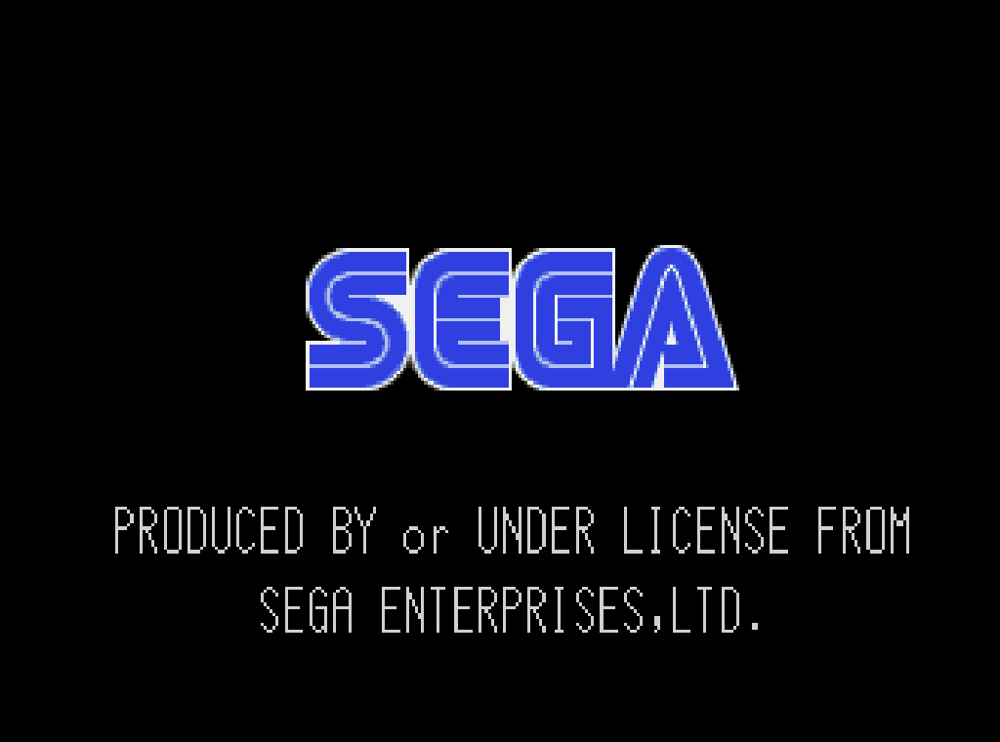

# 模拟器这一层（RetroArch + 自编 libretro 核）

[← 返回 README](../../../README.md)

v21 的模拟器层是**从源码交叉编译**的：`packages/libretro/*/package.mk` 每个核一份，
pin 到具体 commit + SHA256，由框架构建后装进 `/usr/lib/libretro/`。Ubuntu 仓库里有
RetroArch 本身（resolute 是 `retroarch 1.22.2+dfsg`），但**没有任何 libretro 核心包**
（`apt search libretro` 回答 "No such package"），所以核只能自己编 —— 抄现成 .so 的路线
只在闭源/无法构建的东西上才考虑，目前一个都没用到。

参考过的三份外部实现：`lcdyk0517/arkos4clone`（同 SoC 的 prebuilt-rootfs 仓库，不是构建
脚本仓）、`batocera-linux/batocera.linux`、`AveyondFly/distribution_rocknix`。arkos4clone 的
`es_systems.cfg` 有 135 个系统，**不能直接拿来用**：它依赖 ArkOS-ES 的 `%GOVERNOR%` 宏和
`sudo perfmax/perfnorm` 辅助命令，路径也是 `/home/ark`。

## 启动那一刻，显示器只能有一个人用

这块板子上没有 X、没有 compositor，ES 和所有模拟器都是**同一个 DRM card0 的客户端**，
而 DRM master 是独占的：谁先打开 `/dev/dri/card0` 谁是 master，别人 `drmSetMaster` 拿不到。
所以"游戏打不开"这一大类问题的真正变量只有一个 —— **启动子进程的那一刻 ES 有没有放掉
master**。这条链在两处代码上成立：

* `FileData.cpp:718-721` 读 `HideWindow` 并 `window->deinit(hideWindow)`，只有 true 才会走到
  `Renderer::deinit()` → `destroyWindow()` → `SDL_Quit()`（`Renderer.cpp:504-508, 318-336`），
  而 `SDL_Quit()` 才是关掉了那个 card0 描述符、把 master 放回内核的动作；
* 游戏退出后 `window->init(hideWindow)` 再把它抢回来。ES 自己在 `Settings.cpp:362-366` 的
  默认值是 `#if defined(_WIN32) || defined(X86) || defined(X86_64) ? false : true`，
  而这棵树 es-core 的 `CXX_DEFINES` 是
  `-DHAVE_INTL -DHAVE_UDEV -DUSE_OPENGLES_30 -D_ENABLE_KODI_`（一个 X86 都没有），
  所以我们编出来的默认就是 true —— 镜像能启动游戏靠的是这个，不是运气。

两种状态都是**量出来的**，仪器是 `/sys/kernel/debug/dri/0/state`：它会把当前扫描输出的
framebuffer 连它的分配者一起写出来（`allocated by = <15 字符的 comm>`）。ES 在跑时那一行是
`emulationstatio`；让位之后同一行变成游戏自己：

| 条件 | fceumm | fbneoplus(neogeo) | OpenBOR | ONScripter |
| --- | --- | --- | --- | --- |
| ES 持有 master（从 ssh 直接起） | `Fatal error in video_driver_init_internal()` | 同左 | `SDL Failed to Init!!!! (kmsdrm not available)` | 同左 |
| 先 `SDL_Quit()` 再起（= ES 的启动条件） | 面板 `retroarch`，12 s 后被 timeout 杀 | 面板 `retroarch`，rc=124 | 面板 `OpenBOR-ff`，写出 `Saves/00x.cfg` | 面板 `onsyuri`，`Display: 640x480` + `Audio: 44100 Hz` |

于是有两个看起来能用的东西被**否定**了，别再试：

* `SDL_KMSDRM_REQUIRE_DRM_MASTER=0`（`libSDL2-2.0.so.0` 里确实有这个 hint，SDL 2.30.0）
  —— 它只让 `SDL_Init` 返回 0，屏幕仍然归 ES：OpenBOR 带这个变量跑满 20 s，stdout 一路
  `ERROR: Could not queue pageflip: -13`（EACCES），把"当场报错"变成"黑屏且看起来在跑"，
  比原来更难诊断。
* 让 wrapper 去 `systemctl stop r36-es` 再启动游戏 —— ES 是 `r36-es.service` 的主进程，
  systemd 默认 `KillMode=control-group`，stop 会连同正在启动的子进程一起杀掉。真要这么
  做只能 `systemctl kill --kill-who=main`，而既然 ES 自己有让位机制，就不该绕过它。

因此镜像里唯一需要守住的默认值是 `HideWindow=true`，它已经钉在
`packages/ui/es-theme-art-book-next/package.mk` 写出的 `es_settings.cfg` 里；用户侧要打破它
只有菜单里那个开关（`GuiMenu.cpp:1143-1145`），一旦关掉，表现是**所有系统的所有游戏**
点开就退回 ES，而且 ES 自己不报任何错。

## 现在装了哪些核，各自是怎么编出来的

| 系统 | 核（`/usr/lib/libretro/`） | 上游 pin | 构建方式 | 这一步真正的坑 |
| --- | --- | --- | --- | --- |
| nes | `fceumm` | `7a542dab` | `make -f Makefile.libretro platform=unix` | `platform=linux`/`linux-aarch64` 这些 token 它不认识，会掉进 Windows 分支去链 `.dll`，最后死在 `R_AARCH64_ADR_PREG_PG_HI21` |
| snes | `snes9x2010` | `fe690dd3` | 同上 | — |
| gb / gbc | `gambatte` | `d9d6cd06` | 同上 | — |
| gba | `mgba` | `7a12d6d4` | CMake：`-DBUILD_LIBRETRO=on -DSKIP_LIBRARY=on -DBUILD_LTO=OFF` | mgba 自带 `BUILD_LTO` 开关，我们的交叉 gcc **没有编 LTO 支持**，不关就 `cc1: error: LTO support has not been enabled` |
| gba | `vba_next` | `788192f2` | `Makefile.libretro` | — |
| psx | `pcsx_rearmed` | `c8816799` | `Makefile.libretro` | 这棵树带 `./configure`，框架会给它建一个 out-of-tree 构建目录并在里面跑 `make_target()`，所以必须 `cd ${PKG_BUILD}`，否则 `-f Makefile.libretro` 找不到文件 |
| dreamcast | `flycast` | `4e3e2823` | `make -f Makefile platform=arm64 AS=$CC MFLAGS=-mno-outline-atomics HAVE_OPENMP=0 HAVE_VULKAN=0` | 三处见下 |
| saturn | `mednafen_saturn` | `65f05fa6` | `make -f Makefile platform=unix LTO=0` | 这个 Makefile 默认打开 `-flto=auto -fipa-pta`，同上必须关掉 |
| gba | `gpsp_ezode` | `b4918c36` | `make platform=arm64` | 见下，和 flycast 是同一类坑但更阴：`platform=unix` 用**构建机**的 `uname -a` 决定 JIT |
| arcade / neogeo / fbneo / cps1 / cps2 | `fbneoplus` | `8ebb4eea` | `cd ${PKG_BUILD} && make -C src/burner/libretro platform=aarch64` | 第一个坑是 `-C` 相对路径：`make_target()` 不在 `${PKG_BUILD}` 里跑，所以少了 `cd` 就 `src/burner/libretro: No such file or directory` |

街机这一层先把期望讲清楚，因为"能不能跑"取决于 ROM 集而不是核：编出来的树里带
`gamelist.txt`（25,338 个驱动），从游戏包 `fbneo/`、`neogeo/`、`cps1/`、`cps2/` 各抽前 40 个
文件名去比对，**4 个目录全部 40/40 命中**。这只证明命名对得上，不证明 zip 里的 ROM 哈希
对得上 —— FBNeo 和 MAME 一样是按驱动定义校验文件的，真正的结论要等上卡才知道。
`.7z` 也必须进 `<extension>`：`info->valid_extensions = "zip|7z|cue|ccd"`
（`src/burner/libretro/libretro.cpp:515`），而包里的 `fbneo/` 就是 1812 个 `.7z`。
BIOS 的查找路径同样是从 `locate_archive`（同文件 :925-1000）读的：
`<system_directory>/fbneo/<名字>`，而 `retroarch.cfg` 里 `system_directory = "/roms/bios"`，
所以 `neogeo.zip` 放在 `/roms/bios/fbneo/`（es-launcher 已经建好这个目录，游戏包的 `bios/`
里本来就有这个文件）。

gpsp 的坑读代码才能看见，编出来的东西不会报错：`platform=unix` 分支（Makefile:23-34）拿
`$(shell uname -a)` —— **构建机**的 —— 去判断 dynarec，在 x86-64 的 WSL 上它命中
`CPU_ARCH := x86_32`，于是把 `x86/x86_stub.S` 塞进 SOURCES_ASM 让 aarch64 的 gas 去汇编 x86
指令；而它唯一一条自动走 arm64 JIT 的路（Makefile:61-69）要求 `CROSS_COMPILE` 里出现字面量
`webos`。所以只能用 `platform=arm64`（Makefile:380-388：`CPU_ARCH := arm64`、
`HAVE_DYNAREC := 1`、`MMAP_JIT_CACHE = 1`）。核本身编不编 dynarec，产物都是 aarch64、都能
"编译成功"，唯一的区别是慢 —— 配方因此不去 `nm` 符号（`link.T` 只导出 `retro_*`，装好的
`.so` 又被框架 strip 掉），而是断言 `arm/arm64_stub.o` 存在且 `arm_stub.o` 不存在：
Makefile.common:35-44 只在 `CPU_ARCH=arm64` 时追加 `arm64_stub.S`，32 位路径追加
`arm_stub.S`，解释器两个都不追加，而 Makefile:584 把 `SOURCES_ASM` 变成源码同名的 `.o`。

flycast 的三个坑值得单独记，因为它们都不是"参数写错"而是**默认值在交叉编译下是错的**：

1. **`platform=arm64`，不是 `platform=unix`。** unix 分支把 `uname -m` 的结果（构建机是
   x86-64）当 `WITH_DYNAREC`，会给 aarch64 目标编出 x86 dynarec；而且它强制 `HAVE_VULKAN=1`，
   把 vendored glslang 整个拖进来。`arm64` 分支显式 `WITH_DYNAREC=arm64`、`FORCE_GLES=1`
   （本机是 Mesa/Panfrost 的 GLES 3.1，Mali-G31，从 RetroArch 自己的日志量的），Vulkan 保持关闭。
2. **`AS` 必须是编译器驱动。** arm64 分支把 `$(CFLAGS)` 原样塞进 `ASFLAGS`，
   于是 `aarch64-...-as` 会收到 `-DTARGET_LINUX_ARMv8` 和 `-frename-registers`，它不认识。
3. **atomics 只能内联。** 这个 Makefile 自己 `CFLAGS :=`，框架的 `-mno-outline-atomics`
   传不进去，链接就找 `__aarch64_swp4_acq_rel`；而 sysroot 里只有 `libatomic.so.1`
   没有 `-latomic` 的链接名。`MFLAGS` 是它 arm64 路径上唯一没被复写的变量（只有 x86 分支
   会 append），并且编译规则同时把它拼进 C 和 C++ 命令 —— 所以标志走这里。Cortex-A35
   有 LL/SC exclusive，内联出来是对的，只是没有 LSE。

## 启动链：为什么中间要有一个 `r36-play`

```
ES 的 <command> = /usr/local/bin/r36-play %ROM%
   → ES-DE 看见命令里没有 %EMULATOR%/-core，就自己追加 " -emulator retroarch -core <核名>"
      （es-app/src/FileData.cpp:553-557）
   → r36-play 吃掉这两个参数（RetroArch 会把 "-emulator" 当非法参数退出），把核名变成
      /usr/lib/libretro/<核>_libretro.so
   → exec retroarch -c ~/.config/retroarch/retroarch.cfg --appendconfig=/etc/r36/retroarch.cfg \
          --fullscreen -L <那个 .so> <游戏>
```

两个必须成立的条件，都是实测出来的：

- **`/etc/r36/retroarch.cfg` 必须存在**，否则游戏**有画面没声音**：这台机器没有 PulseAudio，
  而 RetroArch 的默认音频驱动就是 pulse。同一个核、同一个游戏，加上
  `audio_driver = "alsa"` 之后 `Initialized PLAYBACK device` 才出现。
- **`<core>` 的名字必须等于已安装库的文件名主干**（`flycast`、`mednafen_saturn`、
  `vba_next`，注意下划线）。`scripts/image` 现在会把装好的 cfg 逐条对着镜像核：每个
  `<system>` 声明的每个 `<core>` 都要有对应 `.so`，每个 `<path>` 目录都要存在且非空 ——
  因为这两种错都**不会**让打包失败，只会让板子上要么启动即退，要么整个系统在 ES 里无声消失。

`r36-play` 还留了一份"没给 `-core` 时按 ROM 所在目录推断"的默认表。加它不是为了好看：
第一次六核验证时，脚本在 ES 外面手工启动，六个系统全部 `rc=4`，而这跟核本身一点关系都没有。

## 实机成绩（64 GB 卡，v21，2026-10-08）

测法要先把两件事分开：

- **日志里的 `Geometry: ... FPS: 60` 是游戏的标称刷新率**，满速和被限速到 25% 长得一模一样，
  不能当成绩用。
- **`retroarch --max-frames=N` 让 RetroArch 跑满 N 个模拟帧后自己退出**，所以墙钟时间除以 N
  就是真实速度。但**一次测量仍然不够**：600 帧在 nes 上是 13.4 s，在 dreamcast 上是 14.7 s，
  而 13.4 s 里有约 3.4 s 是启动（建 GL context、装核、读 BIOS），八个系统单看一次都会得到
  "44 fps"，包括明明满速的 nes。所以每个系统跑两点（600 与 1800 帧），**取斜率**
  `(1800-600)/(t2-t1)`，把常数项消掉。

游戏全部来自游戏包里的**真游戏**，不是手搓的测试 ROM。

**测量前必须先把 ES 停掉。** ES 和 RetroArch 都要 DRM master，ES 在前台时 RetroArch 拿不到
模式设置，日志是 `[KMS] Error when switching mode` → `Cannot open video driver` → 然后在自己的
错误路径里 **SIGSEGV（rc=139）**。这个 139 看起来完全像是"核心崩了"，实际上核心一行代码都没跑。
第一次 N64 测量就是这么被废掉的（`r36-es.service` 装上之后每次开机都有 ES 在前台，所以这个坑
以后每次都会踩）：

```sh
systemctl stop r36-es ; fuser /dev/dri/card0   # 必须是空的
```


| 系统 | 核 | 游戏 | 标称 | 实测持续 | 结论 |
| --- | --- | --- | --- | --- | --- |
| nes | fceumm | 宝石方块.zip | 60.10 | **59.82 fps** | 满速 |
| snes | snes9x2010 | 超级马里奥医生.zip | 60.096 | **60.31 fps** | 满速 |
| gb | gambatte | 打砖块.zip | 59.73 | **59.89 fps** | 满速 |
| gbc | gambatte | 骰子方块.zip | 59.73 | **60.60 fps** | 满速 |
| gba | mgba | 数独.zip | 59.73 | **60.00 fps** | 满速 |
| gba | vba_next | 数独.zip | 59.73 | **62.13 fps** | 满速 |
| psx | pcsx_rearmed | 大航海时代外传[简].PBP | 59.82 | **59.94 fps** | 满速 |
| dreamcast | flycast | 月华剑士2 汉化版.cdi | 60 | **58.85 fps** | 基本满速 |
| dreamcast | flycast | Capcom vs SNK 2.chd | 60 | **55.48 fps** | 92%，个别场面掉帧 |
| saturn | mednafen_saturn | 棉花小魔女 日版.chd | 60 | **14.13 fps** | 不可玩 |
| saturn | mednafen_saturn | 大航海时代2[简].chd | 60 | **15.41 fps** | 不可玩 |

这张表是**从刷好的镜像启动的那张卡**上量的（2026-10-09）。前一天在手工部署的同款文件上也量过
一遍，逐项差都在噪声内（nes 59.84/59.82、dreamcast 59.05/58.85、saturn 14.22/14.13），
所以核的表现与"文件是拷进去的还是装进去的"无关。

两轮共 20 次启动全部 `rc=0`、`errors=0`、`Initialized PLAYBACK device` 至少一次。DC 的日志里有真正的
启动信息（`[BOOT]: Product number: T1249M`），Saturn 认出了盘（`Game ID is: T-9906G`、
`This is a Saturn disc`、`Disc Region: "Japan"`）。

**而且是看得见的**：`--max-frames-ss --max-frames-ss-path=<png>`（两个开关都要给，只给路径会
静默什么都不产出）让 RetroArch 用自己的读回路径出图 —— 这条路上 `--verbose` 拿不到的画面证据
终于有了，而且和"抓 `/dev/fb0` 抓不到 ES"不冲突（见 [EMULATIONSTATION.md](EMULATIONSTATION.md)）：





**一个只在脚本里才会踩到的点**：flycast 对 **SIGTERM 的响应不可靠** —— 同一张卡、同一个游戏，
2026-10-08 那次 `timeout -k 5 12 r36-play <dc 游戏>` 是 `rc=137`（TERM 没生效，靠 KILL 收掉），
第二天同一行命令是 `rc=124`（正常退出）。所以任何"跑 N 秒然后杀"的写法**必须带 `-k`**，
不能假设 TERM 够用。RetroArch 自己的退出路径没这个问题：`--max-frames` 每次都 `rc=0` 干净退出，
菜单里的 Quit 走的是同一条路。也就是说这是**测量脚本**的坑，不是玩家按退出会遇到的坑。

也就是说：**"能不能加载"这一层全过了；DC 在这台机器上是真能玩的；Saturn 差的是速度，
而速度是这颗 SoC 与这个核（satune 没有 ARM dynarec）的上限，不是配置的疏漏。**


## BIOS：三家要三个不同地方，全是实测出来的

| 需要 | 放哪 | 怎么知道的 |
| --- | --- | --- |
| PlayStation | `/roms/bios/SCPH30004R.bin` | 放进去之前 `pcsx_rearmed` 不启动 |
| Dreamcast | **`/roms/bios/dc/dc_boot.bin`**（子目录！） | 直放 `/roms/bios/dc_boot.bin` 时 flycast 报 `Unable to find bios in /roms/bios/dc/`；补上子目录后它还会往同一目录写 `dc_nvmem.bin` 与 `vmu_save_{A..}1.bin`，所以这是"模拟器的存档区"而不只是查找路径。`packages/rk3326/es-launcher` 已经在镜像里建好这个目录 |
| Saturn | `/roms/bios/sega_101.bin`（不是 `saturn_bios.bin`） | 只有 `saturn_bios.bin` 时报 `Cannot open BIOS file "/roms/bios/sega_101.bin"` |

## 加一个新核就是这四步，少一步的表现都不一样

1. `packages/libretro/<核名>/package.mk`：`PKG_TOOLCHAIN="manual"`，pin commit + SHA256
   （**哈希要按 recipe 真正抓的那个 URL 算**：GitHub 把顶层目录名烧进 tarball，branch 形式和
   commit 形式对同一棵树给出不同哈希），`make_target()` 里 `cd ${PKG_BUILD}`，
   `makeinstall_target()` 把 `<核>_libretro.so` 装进 `/usr/lib/libretro/` 并在装之前
   `[ -f ] || die`。
2. `packages/virtual/image/package.mk` 的 `PKG_DEPENDS_TARGET` 加这个名字 —— 否则它只是
   `make build PKG=` 能编出来的一个文件，进不了镜像。
3. `packages/rk3326/es-launcher/es_systems.cfg` 加 `<system>`，`<core>` 写**库文件名主干**；
   如果希望不经过 ES 也能手工启动，再往 `r36-play` 的默认表里加一行。
4. `make image`。打包阶段会把第 3 步逐条对着镜像核（core 有没有 `.so`、path 目录在不在），
   所以前三步里任何一步漏了都会在这里失败，而不是在板子上"没声音/没系统/启动即退"。

## 不走 RetroArch 的两个：OpenBOR 与 ONScripter

上面四步是给 libretro 核的。这两个是**独立引擎**，`<command>` 直接指自己的 wrapper，
没有 `<emulators>`/`<core>`，因为程序本身不是核：

| | OpenBOR | ONScripter |
| --- | --- | --- |
| 配方 | `packages/emulators/openbor-ff` | `packages/emulators/onscripter` |
| 上游 pin | `AveyondFly/openbor-fflns` `5cac6523`，tarball 189 MB，sha256 `2e2ff887` | `YuriSizuku/OnscripterYuri` `08f744b3`，sha256 `7d0b640b` |
| 游戏长什么样 | `/roms/openbor/*.pak`（游戏包里 30 个） | `/roms/onscripter/<游戏目录>/*.ons` 标记文件 |
| 游戏从哪来 | 就是游戏包里的 `openbor/`，27 个 `.pak`（头四字节 `PACK` 魔数，无分卷，最大 401 MB），已拷进卡 | **不在 ROM 那个包里，在另一个卷**：`I:\ONS游戏资源\迷你龙ONS包\ONS`，实测 37 个游戏 33 GB，其中 26 个用 `nscript.dat`、11 个用 `0.txt/00.txt`；包里**没有任何 `.ons`**，标记是这边自己建的。卡上现有两个，正好覆盖引擎的两条分支：`天使的工作`（`nscript.dat`）与 `拂过小镇的旋律之风`（`0.txt`） |
| 为什么必须包一层 | 引擎**没有 rom 参数**：`sdlport.c:30` 把游戏目录硬编码成 CWD 旁的 `Paks`，`menu.c:522` 找不到就打印 `No Mods In Paks Folder!`。所以 wrapper 清空 `Paks/` 里的符号链接、只链本次这一个（连同 `*.pak.0*` 分卷），再 `cd` 过去执行 | 引擎的 root 参数吃的是**目录**不是脚本（`onscripter_main.cpp:370`），而 ES 给的是标记文件，所以 wrapper 取它的 `dirname` |
| 配置落点 | `/roms/.config/openbor`（在 ROM 分区上，用户能自己找到存档；同时在每个 `<path>` 之外，`Paks/` 的符号链接和引擎自建的 `Logs/` 不会被当成游戏扫进来） | 存档由引擎写进游戏目录本身 |
| 环境 | 两个 wrapper 都必须 `export SDL_VIDEODRIVER=kmsdrm SDL_AUDIODRIVER=alsa`（本机跑独立 SDL 程序的唯一可行组合，`r36-port` 早就实测过并写在那里）：这台机器没有 X，游戏运行时也没有 compositor，ES 已经把控制台交出来了；不设置就是"打不开显示"，看起来像引擎自己的 bug |
| 手柄 | 打 0001 号补丁后输入走 `SDL_GameController`（补丁把 `SDL_JoystickOpen` 从 `engine/sdl/control.c` 里**换掉**而不是并存，配方据此断言：两条 API 同时活着会每个键触发两次且没有任何报错）。因此不需要参考发行版那套 `gptokeyb` 假键盘；SDL 初始化会读 CWD 的 `gamecontrollerdb.txt`，wrapper 把 PortMaster 那份 r36max2 映射链过去 | 引擎自己处理 SDL 事件，`-enc:gbk` 是写死的默认值（编码错了照样"跑起来"，只是满屏乱码） |

两个引擎的 `make` 参数也各有一个只能读代码才发现的点，都写进配方的注释里了：

- OpenBOR：`-Werror` **不用去 sed**（参考配方 sed 它，但这个 commit 的 Makefile 里唯一一处
  在 513 行的注释里，516 行的活命令行没有它）；`STRIP` 走 `NO_STRIP=1`（Makefile:259 的
  Linux 分支是裸 `strip`，即宿主 amd64 的 strip 去剥 aarch64 ELF），编完由配方用交叉
  binutils 剥；`pkg-config sdl2 --cflags` 在 519 行被 shell 出来，框架
  `config/functions:218-235` 已经为 target 构建导出了完整的交叉 pkg-config，
  所以**不要**在配方里再声明一遍（我第一版就是这么写的，反而比框架的窄）。
- ONScripter：它的 libretro 目标（`src/onsyuri_libretro`）把 SDL2/SDL_image/SDL_mixer/
  SDL_ttf/bzip2/lua 六个依赖**以 submodule 形式 vendored 进去自己编**，而 GitHub 的 archive
  不解 submodule（实测六个目录 `files=0`）。选它就要再 pin 六个上游，所以走 standalone
  分支（CMakeLists.txt:46-70），代价只是 rootfs-apt 里多五个 `-dev` 包。

**当前状态**（2026-10-12 傍晚）：两个引擎都编出来并进了镜像
（`0f17e54eee4bd3a7…`，`scripts/image` 自检 16 个系统全过、`!!` 计数 0）：
`OpenBOR-ff` 1,733,800 B、`onsyuri` 610,760 B，都是 aarch64。**上机证据已经有了，但都是在
"显示已经让出来"的条件下拿到的**：卡上 dpkg 装上 `liblua5.4-0` 之后，`r36-ons` 打到游戏目录
里的 `stdout.txt` 给出 `Display: 640 x 480 (32 bpp)` + `Audio: 44100 Hz 16 bit stereo` +
`Open GameController 0`，`/sys/kernel/debug/dri/0/state` 里扫描输出的 framebuffer 分配者写成
`onsyuri`；OpenBOR 同理是 `OpenBOR-ff`，而且 `/roms/.config/openbor/Saves/` 里出现
`001.cfg 002.cfg 025.cfg`（进了主菜单才会写）。**还缺的是真从 ES 里按 A 那一次**——上面的
表格是"先 SDL_Quit 再起子进程"的等价复现，不是 ES 本身；钩子已经装在卡的
`/root/.emulationstation/scripts/game-start/90-panel.sh`，它会连续 8 秒记录面板归属、
ES 手里还剩几个 card0 描述符、以及当时在跑的进程，下一次按键就把这最后一个缺口填上。

三个坑只有真编一次才看得见，都记在这儿，因为它们的共同点是**构建日志里不会出现错误**：

1. OpenBOR 的链接命令是 `$(CC) $(CFLAGS) -o $(TARGET) $(OBJS) $(RES) $(LIBS)`，**根本没有
   `LDFLAGS`**。框架的 `-rpath-link` 只在 `LDFLAGS` 里（config/functions:459），于是 libSDL2.so
   自己的 DT_NEEDED 一个都找不到：满屏 `undefined reference to 'XFree'` +
   `warning: libX11.so.6, needed by …/libSDL2.so, not found`。那些库一个都不缺，缺的是
   `-rpath-link`——传递依赖不认 `-L`。修法是把那两个目录并进导出的 `CFLAGS`（这个 Makefile
   只有 `CFLAGS +=`，所以继承的值会留下；写 `CFLAGS=` 到命令行反而会吃掉引擎自己的 `-D/-I/-O`）。
2. onsyuri 链接的是字面量 `lua`，而 Ubuntu 的 `lua5.4-dev` 只给 `liblua5.4.so`。同一份 cmake 输出
   里上一行明明写着 `Found Lua: …/liblua5.4.so (5.4.8)`——找到没用，链接不看它找到的东西。
   自己的补丁 0001 把 `lua` 换成 `${LUA_LIBRARIES}`；副作用是 `DT_NEEDED` 从 dev 符号链接名变成
   带版本的 `liblua5.4.so.0`，这本来就是更对的写法。
3. `MinSizeRel` 会加 `-flto`（CMakeLists.txt:16-19），而这个交叉 gcc 没编 LTO 支持，
   `cc1plus: error: LTO support has not been enabled in this configuration` 是硬错误。
   **这是这台机器上第四个踩同一面墙的包**（mgba 的 `-DBUILD_LTO=OFF`、satune 的 `LTO=0`），
   我还是先信了上游的建议。改成 `Release`，`-s` 由 `${STRIP}` 自己做。

还有一条是这一轮翻出来的框架级问题：**包钩子里一个 `cd` 就能把构建缓存打成废**。
`calculate_stamp` 先把路径削成相对 `$ROOT` 再去哈希，而 `pkg_call` 不套子 shell
（config/functions:1168-1174），所以我 `post_patch()` 里那句 `cd ${PKG_BUILD}` 一路带到
scripts/unpack 写 stamp 的那一刻。实测后果：openbor-ff 的 `.rocknix-unpack` 存的是
`01ba4719…`，正是 `echo '' | sha256sum`，即"内容哈希 = 空输入的哈希"。方向是 survivable 的
（真哈希 vs 空值永远不等 → 每次重编，不会 ship 旧的），但缓存从此不起作用。修法是把 `cd`
放进函数里，验证是同一包在错的 CWD 下现在也给出真哈希。附带量出一个之前不知道的事实：
`${PKG_DIR}/sources/` **是有语义的**——`scripts/unpack:65` 见它就改走私有 unpack 路径，
`:107-109` 还会把里面的东西拷进源码树（实测 `${PKG_BUILD}/r36-openbor` 出现，mode 644）。

`packages/emulators/*/*/sources/` 之所以能进 git，是因为 `.gitignore` 里那条 `sources/` 收窄成了
`/sources/` —— 原来那条不带锚点，把包自己的 `sources/` 也吞了：wrapper 文件躺在磁盘上 git
看不见，只有推完之后在构建机上 `install` 那行才会暴露"文件不存在"。


## 还没做

- **N64：核在树里，系统条目暂时摘掉了。** `packages/libretro/libretro-parallel-n64` 能编出来，
  aarch64 dynarec 也确实在二进制里，但三个真游戏全部在第一帧之前 SIGSEGV，内核寄存器显示
  **`pc = 0x0`**（通过空函数指针调用），位置在视频插件启动处。本机 GL 上下文是 GLES 3.1，
  而默认插件 GLideN64 要桌面 GL 的入口点。试过 `cpucore=interpreter`、换 RSP、换
  `gfxplugin=gles2n64` 都同样崩；`HAVE_GLIDEN64=0` 则链不过。修好之前 `es_systems.cfg` 里
  留着注释说明，恢复只需把那段加回来。详见 [KNOWN-ISSUES.md](KNOWN-ISSUES.md)。
  **不要用"全局强制桌面 GL 上下文"去修**，那会牵动另外 8 个已经正常的核。
- **更重的平台**（PS2 / Switch / 3DS / Wii）：1 GB RAM + Mali-G31 这条线不用试，
  arkos4clone 的 32 位 `retroarch32` 核那一套在本镜像里也跑不了（ABI 是 ARMv7）。
- Saturn 换 `Yaba Sanshiro`（arkos4clone 用它是 standalone SDL 程序，有自己的配置与输入映射）
  能快一些，但它不进 libretro 这条路 —— 要单独接 `<command>`，还没决定值不值。

## 一个已经消掉的 ERROR：`menu_driver`

`/etc/r36/retroarch.cfg` 原来写 `menu_driver = "null"`，于是**每次启动都有一条
`Unable to init menu driver.`**。实测这个 build 接受的取值：`null` → 1 条错误，
`ozone / materialui / rgui / xui` → 0 条。选 `rgui`：它吃手柄方向键，所以游戏内浮层
（核心选项、着色器、存档状态、退出）在这台没有键盘的机器上是**能用**的 —— 当初写 "null"
的理由（"RGUI 需要键盘才逃得出来"）是错的。资源在
`/usr/share/libretro/assets`（Ubuntu 的 `retroarch-assets` 装在这里，不在
`/usr/share/retroarch`），cfg 里现在也写了 `assets_directory`。

