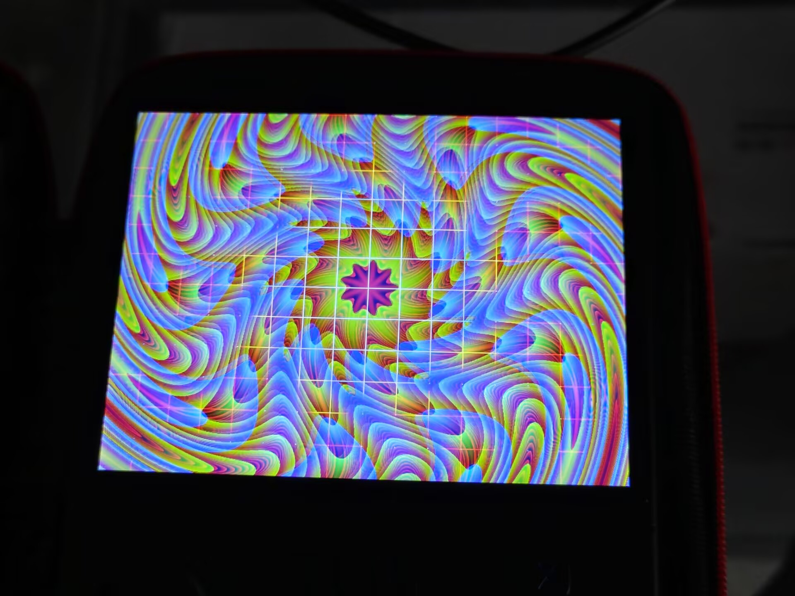

# GPU 上层验证（panfrost + Mesa + GBM + EGL）

[← 返回 README](../../../README.md)

`packages/gpu-demos/r36-gles2-demo.c` 直接拿 DRM master、modeset DSI 连接器、建 GBM surface、
跑动画着色器并扫出，同时用 `glReadPixels` 把结果读回来做数值证明。实测：

| 场景 | 结果 |
| --- | --- |
| 扫出 1024x768（每帧一次 `drmModeSetCrtc`） | 29.8 fps（被显示管线串化成 60 Hz 的一半，不是 GPU 上限） |
| 离屏 FBO，轻着色器 | 59.0 fps / 46.4 Mpix/s |
| 离屏 FBO，48 迭代 Mandelbrot | 32.0 fps / 25.2 Mpix/s |
| devfreq | 负载 480–520 MHz，空载 200 MHz，governor `simple_ondemand` |

真机输出：

```
EGL config   : id 17  buf 30  depth 0  fourcc 0x30335258 (XR30)
GL renderer  : Mali-G31 MC1 (Panfrost)
GL version   : OpenGL ES 3.1 Mesa 26.0.8-1ubuntu0.3
RESULT       : 180 frames in 6.03s = 29.8 fps at 1024x768
readback     : px[0] = 250 242 216        # 和 shader 里的 vec3(0.98,0.95,0.85) 对上
```

镜像里把这两个程序都装好了（`/usr/local/bin/{r36-gles2-demo,egl-probe}`，源码与 Makefile 在
`/usr/local/share/r36-gpu/`），一条命令就能复现上面的结果：

```bash
r36-glcheck          # 6 秒动画扫到屏上，退出时把屏幕交回控制台
r36-glcheck fbo      # 离屏轻着色器
r36-glcheck heavy    # 离屏重着色器
r36-glcheck probe    # 枚举 EGL config 并逐个试 window surface
```



踩过的三个坑，全部值得记死：

1. **一个进程只能有一个 EGLDisplay**。先 `eglGetDisplay(gbm)`+`eglInitialize`+`eglChooseConfig`，
   之后再换成 `eglGetPlatformDisplayEXT` 的 display 并 `eglTerminate` 老的 —— config 属于
   已销毁的 display，`eglCreateContext` 必然 `0x3001 EGL_BAD_PARAMETER`。
2. **Mesa 的 GBM 平台只有 WINDOW 配置**：要 `EGL_PBUFFER_BIT` 直接返回 0 个 config，
   所以"pbuffer 离屏兜底"在这条路上不存在，离屏要自己建 FBO + renderbuffer
   （ES3 下 internalformat 用 `GL_RGBA8`，`GL_RGBA` 会 incomplete）。
3. **`gbm_surface` 的 fourcc 必须取自所选 config 的 `EGL_NATIVE_VISUAL_ID`**，硬写
   `GBM_FORMAT_XRGB8888` 会得到 `0x3009 EGL_BAD_MATCH`。另外 `eglChooseConfig` 的位深是
   **下界**语义，要 8/8/8+`EGL_BUFFER_SIZE 24` 仍会先命中 10-bit 的 XR30。

内核侧还有一个坑：panfrost `probe failed -22`。真因是一句
`vdd_logic: Restricting voltage, 975000-950000uV` —— 主线 `rk3326.dtsi` 的 GPU OPP 最低档要
950 mV，而 `vdd_logic` 已被别的消费者顶在 975 mV，regulator 核心遇到 min>max 直接 EINVAL，
死在 `panfrost_devfreq_init`。修法就是板级 dts 自带一张 OPP 表（见 [`projects/RK3326/dt/rk3326-xifan-r36max2.dts`](../../../projects/RK3326/dt/rk3326-xifan-r36max2.dts)
里的 `r36_gpu_opp`）。顺带：DTC 1.7.2 不接受在所有 `/ { }` 之外写带标签的裸节点。
